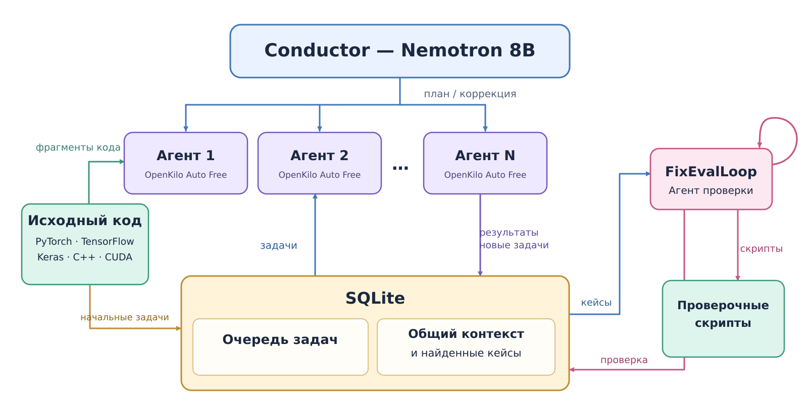

# OptimizationExplorer

Многоагентная система для исследования исходного кода **PyTorch, TensorFlow и Keras**, поиска ветвей, зависящих от оптимизаций, и подготовки проверочных Python-скриптов.



## Как работает

**Conductor (Nemotron 8B)** планирует очередной шаг исследования и подсказывает исправления, когда ответ исполнителя не проходит проверку. **Агенты OpenKilo Auto Free** анализируют переданные им фрагменты Python, C++ и CUDA-кода. Программа проверяет достоверность ссылок на исходники, сохраняет шаги и найденные случаи оптимизации, а при обнаружении подходящих развилок добавляет задачи для исследования альтернативных путей.

**SQLite** служит общим постоянным хранилищем: в нём находятся очередь заданий, состояние исследования, доказательства из исходников и найденные кейсы. Очередь пополняется как при начальном поиске точек входа, так и в ходе исследования. Выбор заданий, постановка новых задач и сохранение выполняются Python-кодом; Conductor не обращается к очереди напрямую.

**FixEvalLoop** — отдельный процесс проверки. Он получает найденные кейсы из SQLite, создаёт проверочные Python-скрипты, запускает их, фиксирует результаты и при неудаче запрашивает исправленный вариант у OpenKilo. Скрипты сохраняются в каталоге результатов, история запусков — в SQLite. Также есть режим генерации скриптов **без запуска**: в нём проверяется корректность кода, но не факт достижения оптимизированной ветви.

## Запуск

Требуются **Python 3.10+**, локальные исходники в `sources/` и настроенные адреса моделей (`ORCHESTRATOR_*`, `OPENKILO_*`). Архив проекта не содержит сами исходники фреймворков; их перечень — в `SOURCES.md`.

```bash
python -m pip install -e .

# Поиск исходных точек исследования
python tools/trace_orchestrator.py --db results/multilayer-live.sqlite --sources sources

# Совместный запуск исследования и проверки кейсов
python tools/agent_supervisor.py --db results/multilayer-live.sqlite --sources sources --out results/case-repros
```

Чтобы только создавать проверочные скрипты без их запуска:

```bash
python tools/fixevalloop.py --db results/multilayer-live.sqlite --sources sources --generate-only --watch
```

> **Важно:** найденная ветвь и успешно созданный скрипт сами по себе не доказывают выполнение конкретного CUDA-ядра или прирост производительности. Это требует отдельной проверки.

## Основные части кода

- `tools/trace_orchestrator.py` — задания, исследование исходников, развилки и сохранение результатов.
- `optimization_explorer/llm.py` — обращения к Nemotron и OpenKilo.
- `tools/fixevalloop.py` — генерация и проверка Python-скриптов.
- `tools/agent_supervisor.py` — запуск и контроль отдельных процессов.
